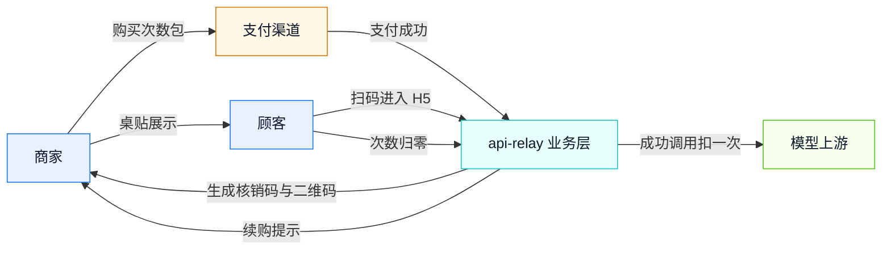

# 需求分析说明书

## 1. 背景与目标

PAYATHON 2026 参赛项目。提交截止 2026-12-09，决赛 2026-12-26。评分权重：产品完整度 30%、支付集成 25%、商业化 25%、影响力 20%。

产品一句话：**商家购买 AI 次数包，系统发核销码与二维码，顾客扫码即可使用 AI，每成功一次扣一次。**

本轮目标不是再做一个聊天框，而是把「线下门店卖 AI」做成可现场演示的完整闭环：商家买包、支付、出码、打印、顾客扫码、对话与画图、次数归零、续购提示、商家查看营收与核销。

商业化口径写死：**卖次数，不卖 token，不碰餐费，不依赖模型厂商返点。** 支付走商家自己的收款能力，AI 成本由中转站按上游实际用量结算，包价与成本之间保留毛利。

## 2. 用户与场景

| 角色 | 核心诉求 | 本系统提供 | 不在本系统内 |
|---|---|---|---|
| 商家 | 一次付费、贴桌即用、看得见核销与营收 | 套餐购买、支付、出码、打印、撤销、统计；管理员邀请后用自己的控制台；外卖单号换码 | 门店 POS、外卖平台订单接口、餐费结算 |
| 顾客 | 不下载、不注册，扫码就能问与画 | 扫码会话、AI 对话、AI 画图、剩余次数 | 账号体系、历史跨设备同步 |
| Agent 调用方 | 按次付费，不要月费与注册 | `POST /agent/v1/chat/completions`、402 + `amtPaymentLink`、`Payment-Proof` 重试 | API key 管理后台、发票、套餐折扣 |
| 运营者 | 一条命令启动、可检查、可备份、可排障 | `relay check`、业务库、日志事件、健康检查、商家邀请与停用 | 多租户后台、分账、发票 |
| 支付渠道 | 标准预下单与异步通知 | `alipay.trade.precreate`、`alipay.aipay.agent.payment.*` 与 RSA2 验签 | 退款、对账文件、资金清算 |

典型场景一：咖啡店购买 100 次对话包，付款后打印 1 张桌贴；顾客扫码问「推荐 3 款招牌饮品」，AI 回答一次扣一次；同一桌多人扫同一个码共享 100 次；用尽后顾客看到续购提示，商家在控制台再买一包，新码立即生效。

典型场景二：运营者创建商家账号并把 `/biz?t=...` 链接发给店主；店主只看到自己的订单、码与营收，看不到别家数据。

典型场景三：一个 AI Agent 调 `POST /agent/v1/chat/completions`，收到 402 与支付链接，用户确认支付后 Agent 带 `Payment-Proof` 重试，拿到结果；同一张凭证重复提交不会二次交付，上游失败可以原凭证重试。

典型场景四：外卖店的每一单都要配一张可追溯的码。店员把平台订单号粘进商家台（或扫码枪录入），系统从已购码池里取一张码绑定该单号，打印 58 mm 热敏标签贴到餐袋上；同一单号重复录入返回原码，不会多耗一张码。顾客收到外卖扫码即用，和到店贴桌共用同一套扣次。

## 3. 功能需求

| 编号 | 需求 | 验收口径 |
|---|---|---|
| FR-01 | 套餐目录 | 配置读取 `business.packs`；未配置时使用内置 3 个示例包；套餐含次数、价格、可用模型、有效期 |
| FR-02 | 商家下单 | 选择套餐与数量 1~20，生成 `pending` 订单；金额 = 单价 × 数量，四舍五入到分 |
| FR-03 | 支付 | `mock` 走本地收银台；`alipay` 走当面付预下单并展示二维码；异步通知验签后置为 `paid` |
| FR-04 | 出码 | 支付成功后按购买数量出码；码格式 `XXXX-XXXX`，含总量、有效期、可撤销；同订单重复通知不重复出码 |
| FR-05 | 顾客会话 | 扫码进入 H5，服务端校验码状态并种签名 Cookie；会话不落库，重启仍有效 |
| FR-06 | AI 调用 | 对话支持 SSE 流式与非流式；画图固定生成 1 张；模型限定在套餐声明的模型内 |
| FR-07 | 扣次 | 一次成功调用扣一次；失败、被拦截、流中途断开不计次；次数用尽返回 402 |
| FR-08 | 商家运营 | 查看订单与码、打印小票、撤销码、查看营收/核销/在用码 |
| FR-09 | 安全 | 商家接口全部要求管理令牌；顾客接口只返回本码数据；relay key 不出现在页面与日志 |
| FR-10 | 可运维 | 业务库与度量库分离；配置可自检；关键事件有结构化日志 |
| FR-11 | 商家邀请与隔离 | 管理员创建商家并拿到一次性明文令牌与 `/biz?t=...` 魔法链接；商家只能看到自己的订单/码/汇总；令牌可重置、商家可停用 |
| FR-12 | AI 按量付费 | `POST /agent/v1/chat/completions` 无凭证回 402 + `amtPaymentLink`；带 `Payment-Proof` 重试验 `active`/金额/订单/交易号；同一交易号只履约一次；上游失败可原凭证重试 |
| FR-13 | 外卖单码 | 外部订单号归一化（去 `#`/空白、转大写）后绑定一张未用码；同一商家同一单号幂等返回原码且不耗池；池空回 409；58 mm × 40 mm 标签含单号、二维码与到期日；绑定不扣次 |

## 4. 非功能需求

| 维度 | 指标 | 落地方式 |
|---|---|---|
| 性能 | 网关自身开销约 1 ms；流式逐字节转发 | 复用既有引擎，业务层只做会话与次数闸门 |
| 可用性 | 业务库故障不导致 `/v1/*` 转发中断 | 业务服务独立装配，未启用时不挂载路由 |
| 安全 | 管理令牌常数时间比较；支付通知验签、金额校验、幂等 | `AdminAuth`、RSA2、`markPaid` 条件更新 |
| 兼容 | Node.js ≥ 22.5；零运行时依赖 | 仅 `node:http`、`node:crypto`、`node:sqlite` |
| 移动端 | 375 px 起可用；触控目标 ≥ 40 px | 内联 HTML + 原生 JS，移动优先 |
| 合规 | 不保存对话正文；业务库只存订单与次数 | 与度量库同口径，正文不落盘 |
| 可观测 | 下单、支付、出码、调用完成、通知拒绝均有事件 | `biz.*` 结构化日志 |

## 5. 边界与不做

| 不做 | 原因 |
|---|---|
| 真实支付宝沙箱/生产联调 | 需要商家 APPID、私钥、公网回调地址与按量付费 `service_id`；本轮只交付可验证适配器 |
| 商家自助注册与找回密码 | 当前为邀请制：管理员创建，商家凭一次性链接进入；补注册体系需要邮箱/短信通道 |
| 退款、分账、发票、对账文件 | 属于支付渠道完整资金链路，本轮不伪称已实现 |
| `/v1/images/edits` 图生图 | 本轮只覆盖生成端点 |
| 外卖平台订单接口对接 | 平台不向个体商户开放订单查询，需资质与商务合作；本轮由店员录入/扫码输入单号，绑定逻辑与单号来源解耦 |
| 餐费/外卖结算 | 产品边界写死：只卖 AI 次数，不碰交易资金 |
| 多实例共享次数闸门 | 当前 `inflight` 为进程内预留；库内 `uses_used` 是权威计数 |

## 6. 验收标准

1. 一条命令跑全量测试 0 fail；新增业务用例覆盖成功、边界、错误三路。
2. 浏览器完成「下单 → 支付 → 出码 → 扫码 → 对话/画图 → 次数归零 → 续购提示」并留存截图与页面读数。
3. `mock` 支付闭环不依赖任何外部凭据；`alipay` 适配器在假网关下签名可验、通知可验、金额不符被拒、重复通知幂等。
4. `relay check` 输出套餐、支付与按量付费配置；业务层未启用时 `/biz` 与 `/s/:code` 不挂载，按量付费未启用时 `/agent/*` 回 404。
5. 商家 A 的令牌看不到商家 B 的订单与码；停用后令牌立即失效。
6. 按量付费：无凭证 402 且不触达上游；凭证重放 402；上游失败后同一凭证可重试成功。
7. 文档 8 篇齐全，mermaid 图通过 8.8.3 解析，接口字段与实现一致。
