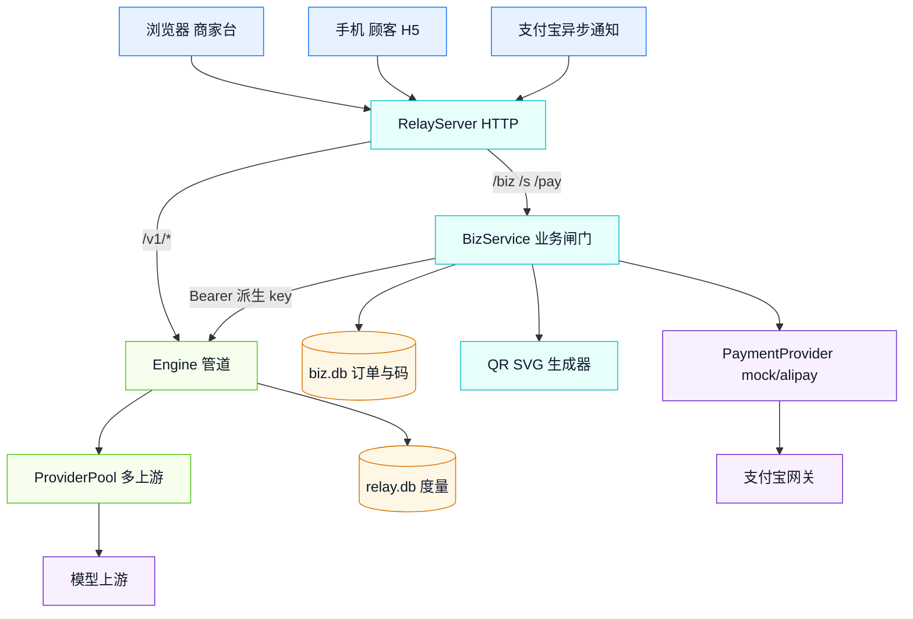
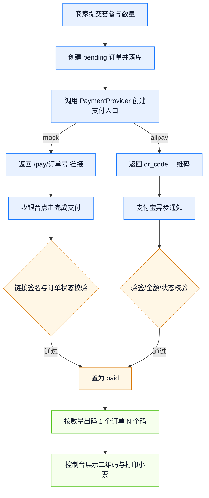
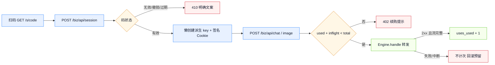
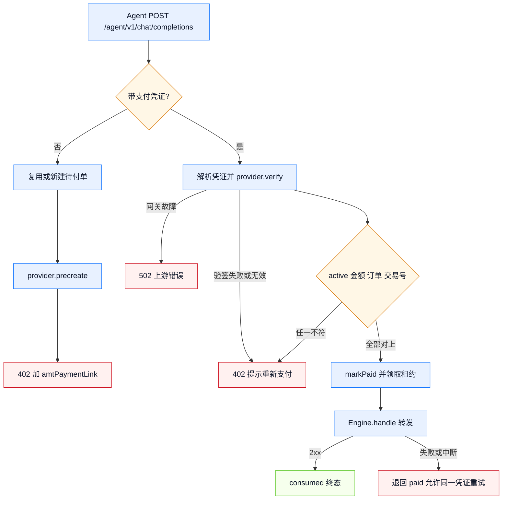

# 概要设计说明书

## 1. 设计原则

1. **业务层只做闸门**：登录态、次数预留、成功扣次放在 `src/biz/`；模型鉴权、路由、失败归因、度量全部复用 `Engine.handle()`，不复制第二套转发逻辑。
2. **两个库分离**：`relay.db` 承担每请求写入的度量；`biz.db` 只写下单、支付、每次成功扣次。两者写入节奏不同，分库避免 SQLite 锁竞争。
3. **明文 key 不落库**：每把核销码对应一把确定性派生的 relay key，库里只存 `keyId`，页面与日志不出现 key。
4. **失败不计次**：调用前只做名额预留，2xx 且流完整结束才把 `uses_used + 1`；失败回滚预留，顾客不吃亏。
5. **零运行时依赖**：二维码、签名、页面全部用内置能力实现，部署只需 Node.js ≥ 22.5。

## 2. 系统分层

## 3. 模块职责

| 模块 | 文件 | 职责 | 明确不做 |
|---|---|---|---|
| 业务路由 | `biz/index.ts` | 页面与 API 分发、商家令牌识别、会话、次数预留、转发、统计、402 履约 | 不实现模型路由与计费 |
| 业务库 | `biz/store.ts` | `biz_order` / `biz_code` / `biz_merchant` / `biz_machine_order` / `biz_slip` 读写、幂等支付、汇总 | 不存对话正文 |
| 套餐目录 | `biz/catalog.ts` | 配置套餐优先、内置示例包、金额取整 | 不做动态定价 |
| 核销码 | `biz/codes.ts` | Crockford Base32 生成、规范化、稳定 keyId | 不承担会话签名 |
| 会话 | `biz/sessions.ts` | HMAC 签名 Cookie、过期校验、Cookie 属性 | 不落会话表 |
| 支付 | `biz/payment.ts` | `PaymentProvider` 接口、mock、支付宝 RSA2 预下单与验签 | 不做退款与对账 |
| 按量付费 | `biz/machinePay.ts` | `Payment-Proof` 解析、mock HMAC 凭证、支付宝 precreate/verify、响应原文验签 | 不保存 `payment_proof` |
| 二维码 | `biz/qr.ts` + `biz/vendor/` | 文本转 SVG、静区、容错级别 M | 不依赖 canvas |
| 页面 | `biz/pages.ts` | 商家台、顾客 H5、收银台、打印页、58mm 标签页、错误页 | 不引入前端构建链 |

商家身份只有两种：管理员（`X-Admin-Token`）与商家（`X-Merchant-Token` 或 `Authorization: Bearer`）。商家令牌只在创建/重置时明文返回一次，库里存 SHA-256；所有订单与核销查询都按 `merchantId` 收窄，跨商家访问按不存在处理（404 而非 403，避免枚举）。

## 4. 订单到发码

幂等点有三处：`markPaid` 只允许 `pending → paid`；`ensureCodes` 发现订单已有码就直接返回；支付宝重复通知同样回 `success`。

## 5. 顾客调用链

`inflight` 只在进程内有效，用于同进程并发请求不超卖；进程重启后以库内 `uses_used` 为准。多实例部署时每个实例各自预留，总量可能被小幅超用，当前版本接受这个边界。

## 6. 按量付费链路

两处刻意的分界：

- **验签层故障与凭证无效分开报**。网关 5xx、响应未签名、超时属上游故障（502），不能告诉调用方「你的凭证无效」——那会诱导它重新付一次钱。
- **失败不消耗支付**。只有 2xx 才 `consumed`；上游失败把订单退回 `paid` 并清空租约，同一张凭证可重试。`trade_no` 的部分唯一索引保证同一笔钱最多交付一次。

## 7. 关键设计决策

| 决策 | 选定方案 | 理由 | 撤销条件 |
|---|---|---|---|
| 次数口径 | 一次成功调用 = 一次 | 顾客感知公平，失败不扣 | 上游出现大量「2xx 但内容为空」时改为按内容校验 |
| 码与 key | 一码一 key，确定性派生 | 重启后可重建，key 不入库 | 需要按子账号隔离时改为每会话一 key |
| 码的共享 | 一个码一个共享次数池 | 桌贴场景多人扫同一码 | 需要一人一码时改为下单出多码 |
| 业务库 | SQLite 独立 `biz.db` | 写入少、事务简单、零依赖 | 多实例写入同一库时迁移到服务型数据库 |
| 支付 | mock 默认 + alipay 适配器 | 无资质也能完整演示 | 沙箱密钥到位后切 `provider: alipay` |
| 页面 | 内联 HTML + 原生 JS | 无构建、单文件部署、改起来快 | 页面复杂度超过单文件维护阈值时引入构建链 |
| 商家接入 | 管理员创建 + 魔法链接（`/biz?t=...`） | 邀请制可控，商家无需注册与记密码 | 需要商家自助注册时补邮箱/短信验证 |
| 按量付费 | 独立 402 入口 + 独立订单表 | 与次数包解耦；Agent 侧只按 HTTP 语义接入 | 支付宝要求改为标准化收款链路时重评估 |
| 凭证失败口径 | 上游故障 502 / 凭证无效 402 | 避免把渠道故障误导成「重新付钱」 | 支付宝 verify 大量超时时加本地缓存与重试队列 |

## 8. 部署形态

单进程同时提供 `/v1/*`、`/admin`、`/biz`、`/s/:code`、`/pay/:orderId`、`/agent/*`。对外由反向代理终结 TLS；二维码基址由 `business.publicBaseUrl` 固定，避免手机扫到 `127.0.0.1`。业务层未启用时，相关路由不挂载，网关保持原有点数与行为；`business.machinePay.enabled=false` 时 `/agent/*` 回 404 且不影响其他入口。
