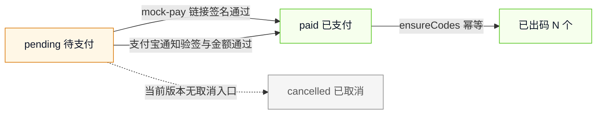
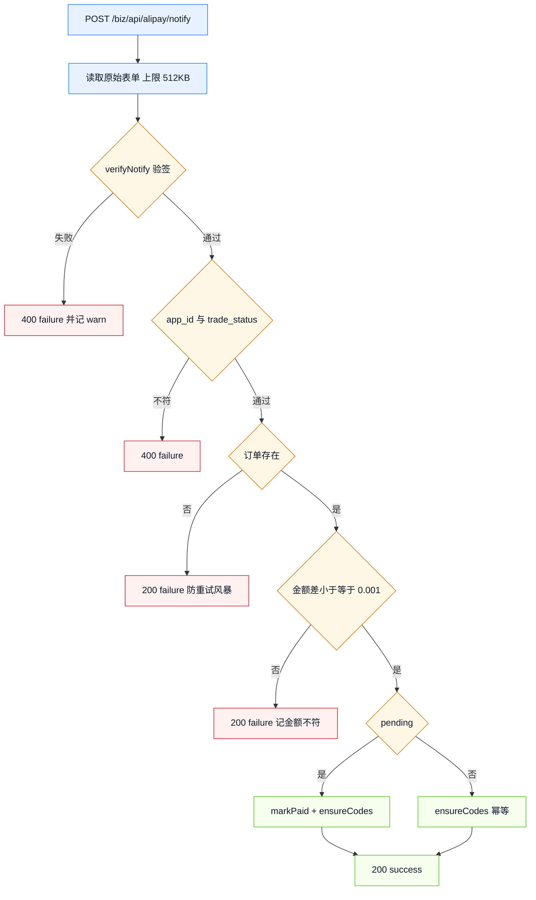
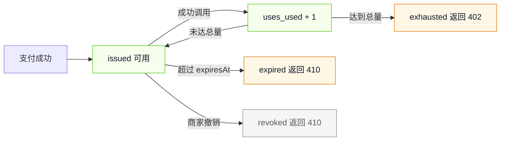
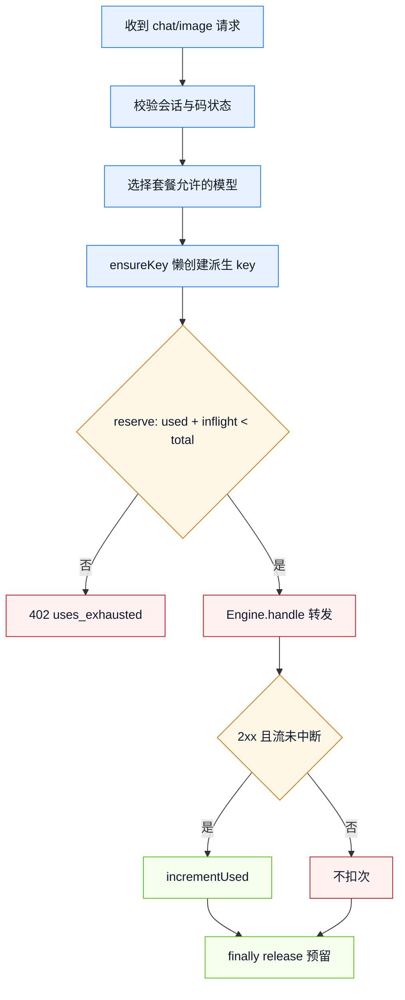

# 详细设计说明书

## 1. 订单状态



`markPaid` 的 SQL 带 `WHERE status='pending'`，返回 `changes>0` 才算本次完成迁移；重复通知、重复点击收银台都不会二次出码。支付入口创建失败时订单保留 `pending`，商家可在订单列表点「去支付」重试。

## 2. 下单与支付入口

1. 校验 `packId` 存在、`quantity` 为 1~20 的整数；`merchantName` 截断到 60 字符。
2. 订单 ID 形如 `ord_<36 进制时间><6 位随机>`，与库内已有 ID 冲突时重新生成。
3. 写入套餐快照：`usesTotal`、`validDays`、`models` 取当下配置，之后改配置不影响已售订单。
4. `amountCny = round(priceCny × quantity × 100) / 100`。
5. `mock` 返回 `/pay/<orderId>?t=<HMAC 链接令牌>`；`alipay` 返回 `qr_code` 字符串，控制台同时渲染 `payQrSvg`。

`mock` 链接令牌 = `HMAC-SHA256(seed, "mock-pay:" + orderId)` 取 base64url 前 24 字符，常数时间比较。没有该令牌不能把订单改为已支付。

## 3. 支付通知



响应体必须是纯文本 `success`；支付宝对非 `success` 会继续重试。通知处理不依赖登录态，验签与金额校验就是安全边界。

## 4. 核销码生命周期



- 码字符集为 Crockford Base32，去掉 `I/L/O/U`，8 位分两段展示；接受大小写与不带连字符的输入。
- 过期时间 = `paidAt + validDays × 86400000`，出码时一次算定。
- 撤销只写 `revoked_at`，不删码；同时尽力吊销对应 relay key，key 不存在时以码状态为准。
- 码不存在、已撤销、已过期统一返回 410，文案区分原因；次数用尽返回 402。

## 5. 顾客会话

`POST /biz/api/session {code}` 校验码状态后，签发 `biz_sid` Cookie：值为 `base64url(JSON{sid,code,exp}).HMAC-SHA256`。Cookie 属性 `HttpOnly; SameSite=Lax; Path=/; Max-Age=<ttl*3600>`，HTTPS 场景加 `Secure`。服务端不存会话，签名密钥由 `adminToken + storage.path` 派生，重启后旧 Cookie 仍能验证。

会话只证明「这台设备扫过这个码」，不替代码状态检查：每次 `/me`、`/chat`、`/image` 都重新读库判断撤销、过期、用尽。

## 6. 调用与扣次



对话请求把 `model/messages/stream/temperature/top_p/max_tokens/stop` 重新组装后转发；`model` 不在套餐内时回落到套餐第一个模型。画图请求固定 `n=1`、`size` 默认 `1024x1024`，`prompt` 截断到 2000 字符，避免一次扣费产出多张图。

流式路径逐块写回并等待 drain；客户端断开、`deadlineAt` 超时、写入异常都算中断，不扣次。引擎返回 JSON 时，2xx 且图片数组非空才扣次。

## 7. 派生 key 与成本止损

```text
secret   = "sk_pk_" + hex(HMAC-SHA256(seed, "relay-key:" + code))[0..32]
keyId    = "pk_" + code 去掉连字符并小写
quotaCny = max(0.01, round(unitPriceCny × costCapRatio, 2))
```

`ensureKey` 先 `resolveSecret`：命中且状态 `ok` 直接复用；命中但被禁用/过期则 `update` 恢复；未命中才 `create`，层为 `standard`，`tenantId = biz_<orderId>`，`allowedModels` 与 `expiresAt` 跟码一致。key 明文只在内存中传递给引擎，库内只有 `key_id`。

## 8. 按量付费履约

```text
outTradeNo  = "mp_" + base36(now) + "_" + hex(random6)
amountCny   = round(priceCny, 2)
payBeforeAt = now + payBeforeMinutes × 60000
leaseMs     = 300000
```

建单：先按 `(serviceId, amountCny)` 查 `pay_before_at > now` 的 `pending` 单，命中则复用；
没有才新建并调 `precreate`。预下单号落库后，**同一张单不再重复预下单**，402 的
`amtPaymentLink` 与 `payment.outTradeNo` 对同一段支付窗口保持稳定。

履约顺序（每一步失败都提前返回，且不打上游）：

1. `parsePaymentProof`：Base64 → `{protocol:{payment_proof,trade_no}, method:{client_session}}`，非法即 402。
2. `provider.verify`：mock 验 HMAC；alipay 调 `alipay.aipay.agent.payment.verify`，**响应按原始 JSON 子串验签**。
3. 对账：`active === true`、金额按分相等、`out_trade_no` 属于本服务、verify 的 `trade_no` 与凭证一致、`resourceId` 一致（若配置）。
4. `markMachinePaid`：只有 `pending → paid` 有效；`trade_no` 撞唯一索引说明这笔钱已履约，回 402。
5. `leaseMachineOrder`：`paid → processing`，或回收 `started_at < now - 5min` 的崩溃残留；正在执行回 402 `payment_in_progress`。
6. `Engine.handle` 转发；2xx 才 `consumed`，否则退回 `paid` 并清空 `started_at`，同一凭证可重试。

`payment_proof` 只在内存中传给 verify，**不落库、不写日志**；库里保留的是 `out_trade_no`、`trade_no`、`resource_id`。
按量付费的内部 key 由 `HMAC(seed, "machine-key:" + serviceId)` 派生，`allowedModels` 收敛到 `machinePay.models`，
不设次数与金额配额——闸门已在 402 链路，重复设闸会在付款成功后误伤。

## 9. 错误码

| HTTP | code | 触发条件 |
|---|---|---|
| 400 | `invalid_code` | 码格式不合法 |
| 400 | `invalid_json` | 请求体不是 JSON 对象 |
| 400 | `messages_required` | 对话 `messages` 为空 |
| 400 | `prompt_required` | 画图 `prompt` 为空 |
| 400 | `pack_not_found` | 套餐 ID 不存在 |
| 400 | `invalid_quantity` | 数量不在 1~20 |
| 400 | `invalid_merchant_name` | 商家名称不在 1~60 字符 |
| 401 | `biz_token_invalid` | 管理/商家令牌缺失、无效或商家已停用 |
| 401 | `session_expired` | 顾客 Cookie 缺失/过期/签名不符 |
| 402 | `uses_exhausted` | 码剩余次数为 0 |
| 402 | `payment_required` | 按量付费未带凭证，附 `amtPaymentLink` |
| 402 | `payment_proof_invalid` | 按量付费凭证非法或 `active=false` |
| 402 | `payment_order_mismatch` | 凭证订单不存在或 `service_id` 不符 |
| 402 | `payment_amount_mismatch` | 凭证金额与订单不一致 |
| 402 | `payment_trade_mismatch` | verify 交易号与凭证不一致 |
| 402 | `payment_resource_mismatch` | 资源标识与配置不一致 |
| 402 | `payment_trade_used` | 同一交易已履约 |
| 402 | `payment_in_progress` | 另一请求持有执行租约 |
| 403 | `admin_required` | 商家令牌调用管理员接口 |
| 403 | `bad_pay_token` | mock 收银台 / mock 按量支付链接令牌不符 |
| 404 | `order_not_found` | 订单不存在 |
| 404 | `code_not_found` | 核销码不存在 |
| 404 | `merchant_not_found` | 商家不存在 |
| 404 | `machine_pay_disabled` | 按量付费未启用时访问 `/agent/*` |
| 409 | `order_not_pending` | 已支付/已取消订单再次取支付链接 |
| 409 | `mock_disabled` | 非 mock 模式调用 mock-pay |
| 409 | `order_consumed` | mock 按量支付页对应订单已履约 |
| 410 | `code_unusable` | 码不存在/撤销/过期（会话接口） |
| 413 | `request_too_large` | 请求体超过 `maxBodyBytes` |
| 500 | `key_create_failed` | 派生 key 创建失败 |
| 502 | `upstream_error` | 引擎调用异常，本次不计次 |
| 502 | `payment_create_failed` | 支付入口创建失败，订单保留 |
| 502 | `precreate_failed` | 按量付费预下单失败，订单保留 |
| 502 | `payment_verify_failed` | 按量付费验签层/传输层故障 |
| 503 | `no_model` | 套餐未绑定可用模型 |

## 10. 页面状态

商家台：未登录壳、加载中、空订单、订单列表、支付弹窗、二维码卡片、错误 toast。
顾客页：会话建立中、正常对话、流式打字、画图加载、图片网格、次数用尽遮罩、码失效遮罩。
打印页：A4 两列三行卡片，每卡含商家名、码、二维码、剩余次数、有效期。
外卖标签：58 mm × 40 mm 单页单码，含商家名、套餐与次数、外部订单号、26 mm 二维码与到期日。
