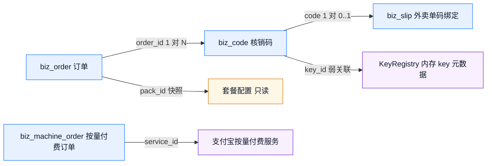

# 数据库设计说明书

## 1. 存储选型

业务库使用 SQLite，文件默认与度量库同目录的 `biz.db`；`storage.driver=memory` / `business.storagePath=:memory:` 时使用内存实现。选型理由：订单与核销写入频率低（下单、支付、每次成功调用各一次），单文件零运维；与每请求写入的 `relay.db` 分库，避免 WAL 锁竞争。

连接参数：`journal_mode=WAL`、`synchronous=NORMAL`、`busy_timeout=3000`。建表使用 `CREATE TABLE IF NOT EXISTS`，重复启动幂等。

## 2. 表关系

`biz_order` 与 `biz_code` 是一对多；`key_id` 指向 `KeyRegistry` 的元数据，业务库不保存 key 明文。套餐信息在下单时快照进订单，配置变更不影响已售订单。`biz_machine_order` 是按量付费的独立订单表，不与次数包订单关联——两者是两种卖法，唯一的共同点是都落在同一个 `biz.db` 里便于一起备份。

`biz_slip` 是核销码与外卖平台订单号的绑定表，只增加一层查找关系，不改变码本身的扣次口径：一张码最多绑一个外部单号（`code` 为主键），同一商家范围内一个外部单号最多绑一张码（`merchant_id` + `external_no` 唯一）。表里不存平台订单内容，只存号码，因此外卖平台换接口不影响存量绑定。

## 3. biz_order

| 字段 | 类型 | 约束 | 说明 |
|---|---|---|---|
| `id` | TEXT | PRIMARY KEY | `ord_` + 36 进制时间 + 随机串 |
| `merchant_name` | TEXT | NOT NULL | 商家展示名，最长 60 字符 |
| `pack_id` | TEXT | NOT NULL | 套餐 ID |
| `pack_name` | TEXT | NOT NULL | 下单时套餐名快照 |
| `quantity` | INTEGER | NOT NULL | 购买数量 1~20 |
| `unit_price_cny` | REAL | NOT NULL | 下单时单价快照 |
| `amount_cny` | REAL | NOT NULL | 应付金额，= 单价 × 数量 |
| `uses_total` | INTEGER | NOT NULL DEFAULT 0 | 每码总次数快照 |
| `valid_days` | INTEGER | NOT NULL DEFAULT 90 | 有效期天数快照 |
| `models_json` | TEXT | NOT NULL DEFAULT `[]` | 允许模型数组的 JSON |
| `status` | TEXT | NOT NULL | `pending` / `paid` / `cancelled` |
| `provider` | TEXT | NOT NULL | `mock` / `alipay` |
| `provider_trade_no` | TEXT | 可空 | 渠道交易号 |
| `created_at` | INTEGER | NOT NULL | 毫秒时间戳 |
| `paid_at` | INTEGER | 可空 | 支付完成毫秒时间戳 |

## 4. biz_code

| 字段 | 类型 | 约束 | 说明 |
|---|---|---|---|
| `code` | TEXT | PRIMARY KEY | `XXXX-XXXX`，Crockford Base32 |
| `order_id` | TEXT | NOT NULL | 所属订单 |
| `pack_id` | TEXT | NOT NULL | 套餐 ID |
| `merchant_name` | TEXT | NOT NULL | 商家展示名 |
| `uses_total` | INTEGER | NOT NULL | 总次数 |
| `uses_used` | INTEGER | NOT NULL DEFAULT 0 | 已成功调用次数，权威计数 |
| `key_id` | TEXT | NOT NULL | 派生 key 的稳定 ID |
| `created_at` | INTEGER | NOT NULL | 出码时间 |
| `expires_at` | INTEGER | NOT NULL | 到期时间 = paidAt + validDays |
| `revoked_at` | INTEGER | 可空 | 撤销时间，非空即失效 |
| `first_seen_at` | INTEGER | 可空 | 首次扫码时间，`COALESCE` 只写第一次 |

## 5. biz_machine_order

| 字段 | 类型 | 约束 | 说明 |
|---|---|---|---|
| `out_trade_no` | TEXT | PRIMARY KEY | `mp_` + 36 进制时间 + 随机串，作为商户订单号 |
| `service_id` | TEXT | NOT NULL | 支付宝按量付费服务标识 |
| `amount_cny` | REAL | NOT NULL | 单次价格，下单时快照 |
| `goods_name` | TEXT | NOT NULL | 商品名快照 |
| `status` | TEXT | NOT NULL | `pending` / `paid` / `processing` / `consumed` |
| `amt_pre_pay_id` | TEXT | 可空 | 支付宝预下单号，用于 `amtPaymentLink` 响应头 |
| `trade_no` | TEXT | 可空，部分唯一 | 支付宝交易号；`WHERE trade_no IS NOT NULL` 唯一 |
| `resource_id` | TEXT | 可空 | verify 返回的资源标识 |
| `created_at` | INTEGER | NOT NULL | 建单毫秒时间戳 |
| `pay_before_at` | INTEGER | NOT NULL | 支付截止毫秒时间戳 |
| `paid_at` | INTEGER | 可空 | 凭证首次验证通过时间 |
| `started_at` | INTEGER | 可空 | 本次执行租约开始时间；失败退回 `paid` 时清空 |
| `consumed_at` | INTEGER | 可空 | 成功交付时间 |

状态机：`pending → paid → processing → consumed`；`processing` 持有 5 分钟执行租约，
上游失败时 `finish` 把状态退回 `paid`（保留 `trade_no`），同一凭证可重试；
`consumed` 为终态，重放一律拒绝。`paid_at` 只在首次迁移写入，重复 verify 不覆盖。

## 6. biz_slip

| 字段 | 类型 | 约束 | 说明 |
|---|---|---|---|
| `code` | TEXT | PRIMARY KEY | 被绑定的核销码，一张码只能绑一单 |
| `merchant_id` | TEXT | NOT NULL | 归属商家；空串表示管理员自营订单 |
| `external_no` | TEXT | NOT NULL | 归一化后的外部平台订单号，大写、去空白、去前导 `#` |
| `order_id` | TEXT | NOT NULL | 码所属的次数包订单，便于按订单回查 |
| `created_at` | INTEGER | NOT NULL | 绑定毫秒时间戳 |

绑定是幂等的：同一 `(merchant_id, external_no)` 重复提交返回原码，不再消耗池内码。绑定不写 `uses_used`，次数仍只在顾客调用成功时扣减。

## 7. 索引

| 索引 | 表 | 用途 |
|---|---|---|
| `idx_biz_order_created` | `biz_order(created_at)` | 订单列表按时间倒序 |
| `idx_biz_code_order` | `biz_code(order_id)` | 订单详情带出全部码 |
| `idx_biz_code_created` | `biz_code(created_at)` | 码列表与运营巡检 |
| `uq_biz_slip_external` | `biz_slip(merchant_id, external_no) UNIQUE` | 同一商家一个外部单号只绑一张码 |
| `idx_biz_slip_created` | `biz_slip(merchant_id, created_at)` | 按商家列出最近绑定 |
| `idx_biz_machine_status` | `biz_machine_order(status, pay_before_at)` | 复用待付单与租约回收 |
| `uq_biz_machine_trade` | `biz_machine_order(trade_no) WHERE trade_no IS NOT NULL` | 同一笔交易只允许履约一次 |

`biz_code.code` 是主键，扫码查询走主键索引；`biz_order.id` 是主键，支付通知按订单号查询走主键索引；`biz_slip.code` 是主键，扫码后反查外部单号走主键，外部单号反查码走复合唯一索引。

分配待绑码的查询按 `biz_order.merchant_id` + 码状态过滤（未撤销、未过期、有余次）并对 `biz_slip` 做 `LEFT JOIN ... IS NULL`，只取最早一张未绑定的码，避免多进程同时领到同一张。

## 8. 迁移与兼容

初始化时依次执行三条 `ALTER TABLE`：补 `uses_total`、`valid_days`、`models_json`。每条独立 `try/catch`，列已存在时忽略。早期开发库的订单快照三列因此可以原地升级。

新增字段的规则：只允许可空列，带默认值的非空列必须同时写回填语句；读取侧对缺失字段给安全默认值（`parseModels` 解析失败返回空数组）。

## 9. 数据生命周期

| 数据 | 写入时机 | 保留策略 |
|---|---|---|
| 订单 | 下单、支付迁移 | 长期保留，用于营收与对账 |
| 按量付费订单 | 402 建单、验证、履约 | 长期保留；未支付单在截止前复用，不无限建单 |
| 核销码 | 支付成功出码、扣次、撤销 | 长期保留；过期与撤销不删除 |
| 外卖单码绑定 | 商家绑定外部单号 | 长期保留；撤销码不回删绑定，便于复盘“这一单被扫过没有” |
| 扫码首次时间 | 首次会话 | 随码保留 |
| 顾客会话 | 不落库 | Cookie 过期即消失 |
| 对话正文 | 不落库 | 不存在 |

`summary(now)` 的口径：营收只累加 `status='paid'` 的 `amount_cny`；在用码要求 `revoked_at IS NULL`、`expires_at > now`、`uses_used < uses_total`；已售次数累加全部码的 `uses_total`，已核销累加 `uses_used`。

## 10. 备份与恢复

备份必须同时包含 `relay.db` 与 `biz.db`。只备份前者会丢订单、码与核销进度。恢复步骤：停服务 → 覆盖两个库文件 → 启动 → `GET /biz/api/summary` 核对营收与已核销数。WAL 模式下复制前先执行 `sqlite3 biz.db ".backup 'biz.backup.db'"`，避免拖走未合并的 `-wal` 文件。
