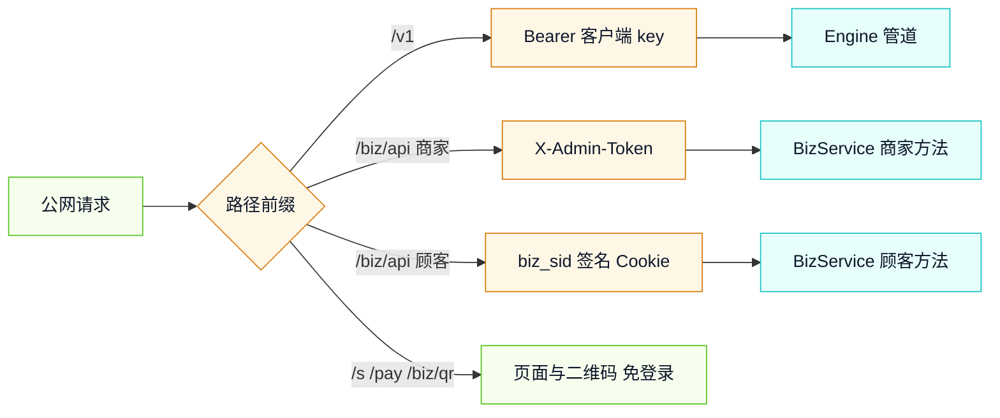

# 接口设计文档

## 1. 通用约定

- 基础路径：业务页面与接口都挂在网关同一端口；`/v1/*` 保持原协议不变。
- 商家接口鉴权：请求头 `X-Admin-Token: <token>`，也接受 `Authorization: Bearer <token>`。未配置 `server.adminToken` 时只接受本机请求。
- 顾客接口鉴权：`biz_sid` 签名 Cookie，由 `POST /biz/api/session` 种下。
- 错误体统一为 `{"error":{"message":"人类可读","type":"...","code":"..."}}`。
- 金额单位人民币元，保留两位小数；时间戳单位毫秒；次数为整数。
- 顾客接口只返回本码数据；订单与码管理接口全部要求管理令牌。



## 2. 端点总表

| 方法 | 路径 | 鉴权 | 说明 |
|---|---|---|---|
| GET | `/biz` | 无（页面壳） | 商家控制台 |
| GET | `/s/:code` | 无（页面壳） | 顾客 H5 |
| GET | `/pay/:orderId` | 链接令牌 `t` | mock 收银台 |
| GET | `/biz/qr/:code.svg` | 无 | 二维码 SVG |
| GET | `/biz/print/:orderId` | 管理令牌 | 可打印小票 |
| GET | `/biz/label/:code` | 管理令牌 / 商家令牌 | 58mm 外卖单码标签页 |
| POST | `/biz/api/alipay/notify` | RSA2 验签 | 支付宝异步通知 |
| POST | `/biz/api/session` | 无 | 校验码并种 Cookie |
| GET | `/biz/api/me` | Cookie | 剩余次数与有效期 |
| POST | `/biz/api/chat` | Cookie | 转发对话 |
| POST | `/biz/api/image` | Cookie | 转发画图 |
| GET | `/biz/api/packs` | 管理令牌 | 套餐列表 |
| POST | `/biz/api/orders` | 管理令牌 | 下单并取支付入口 |
| GET | `/biz/api/orders` | 管理令牌 | 订单列表含码 |
| GET | `/biz/api/orders/:id/pay-link` | 管理令牌 | 待支付订单重新取支付入口 |
| POST | `/biz/api/orders/:id/mock-pay` | 链接令牌 `t` | 标记已支付并出码 |
| GET | `/biz/api/orders/:id/codes` | 管理令牌 | 订单的码 |
| POST | `/biz/api/codes/:code/revoke` | 管理令牌 | 撤销码 |
| GET | `/biz/api/summary` | 管理令牌 | 营收/核销/在用码 |
| POST | `/biz/api/slips/bind` | 管理令牌 / 商家令牌 | 外部订单号绑定一个核销码（幂等） |
| GET | `/biz/api/slips` | 管理令牌 / 商家令牌 | 最近绑定列表 |
| GET | `/biz/api/whoami` | 管理令牌 / 商家令牌 | 当前身份 |
| GET | `/biz/api/merchants` | 管理令牌 | 商家列表（含单量/营收） |
| POST | `/biz/api/merchants` | 管理令牌 | 创建商家，明文令牌只返回一次 |
| POST | `/biz/api/merchants/:id/rotate` | 管理令牌 | 重置商家令牌 |
| POST | `/biz/api/merchants/:id/disable` | 管理令牌 | 停用商家 |
| POST | `/biz/api/merchants/:id/enable` | 管理令牌 | 启用商家 |
| POST | `/agent/v1/chat/completions` | `Payment-Proof` 或 402 预下单 | 按量付费对话入口 |
| GET | `/agent/mock-pay` | 链接令牌 `t`（仅 mock） | 演示支付，签发凭证 |

## 3. 商家接口

### 3.1 GET /biz/api/packs

响应：`{"packs":[{"id":"chat-100","name":"标准对话 100 次","uses":100,"priceCny":9.9,"models":["mock-small"],"validDays":90,"description":"..."}]}`。未配置套餐时返回内置 3 个示例包。

### 3.2 POST /biz/api/orders

请求：`{"packId":"chat-100","quantity":2,"merchantName":"外卖示范商户"}`。`quantity` 取整后必须在 1~20。
响应：`{"order":{...},"payment":{"kind":"redirect","payUrl":"/pay/ord_xxx?t=..."}}`。支付宝模式 `kind` 为 `qr`，另带 `payUrl`（二维码内容）与 `payQrSvg`。
错误：400 `pack_not_found` / `invalid_quantity`；502 `payment_create_failed`（订单已创建，可重试支付）。

订单视图字段：`id, merchantName, packId, packName, quantity, unitPriceCny, amountCny, usesTotal, validDays, models, status, provider, createdAt, paidAt?, codes[]`。
码视图字段：`code, orderId, packId, merchantName, usesTotal, usesUsed, remaining, createdAt, expiresAt, revokedAt?, firstSeenAt?, scanPath, scanUrl?`。

### 3.3 GET /biz/api/orders

响应：`{"orders":[订单视图]}`，按创建时间倒序，最多 100 条。每单带 `codes` 数组。

### 3.4 GET /biz/api/orders/:id/pay-link

仅 `pending` 订单可用。响应同 3.2 的 `order` 与 `payment`。错误：404 `order_not_found`；409 `order_not_pending`；502 `payment_create_failed`。

### 3.5 POST /biz/api/orders/:id/mock-pay

请求：`{"t":"链接令牌"}`。仅 mock 模式可用。响应：`{"ok":true,"order":订单视图}`。
错误：403 `bad_pay_token`；404 `order_not_found`；409 `mock_disabled` / `order_cancelled`。

### 3.6 GET /biz/api/orders/:id/codes

响应：`{"codes":[码视图]}`。错误：404 `order_not_found`。

### 3.7 POST /biz/api/codes/:code/revoke

响应：`{"ok":true,"alreadyRevoked":false}`。错误：400 `invalid_code`；404 `code_not_found`。

### 3.8 GET /biz/api/summary

响应：`{"orderCount":1,"paidOrderCount":1,"revenueCny":19.8,"codeCount":2,"activeCodeCount":2,"usesSold":200,"usesUsed":3}`。`activeCodeCount` 只统计未撤销、未过期、未用尽的码。商家令牌只汇总自己的订单与码。

### 3.9 GET /biz/api/whoami

管理员：`{"kind":"admin","merchantName":"外卖 AI 示范商户"}`。
商家：`{"kind":"merchant","merchant":{"id":"mch_...","name":"...","createdAt":...,"orderCount":2,"paidOrderCount":1,"revenueCny":9.9}}`。
令牌缺失或无效：401 `biz_token_invalid`；商家已停用同样 401。商家令牌调用管理员接口：403 `admin_required`。

### 3.10 POST /biz/api/merchants

请求：`{"name":"城南咖啡","note":"可选备注"}`，`name` 1~60 字符。
响应：`{"merchant":{...},"token":"mch_...","consolePath":"/biz?t=..."}`。
**`token` 只在这里出现一次**，库里只存 SHA-256；响应头 `cache-control: no-store`。错误：400 `invalid_merchant_name`；401 `biz_token_invalid`；403 `admin_required`。

### 3.11 GET /biz/api/merchants

响应：`{"merchants":[{id,name,note?,createdAt,disabledAt?,orderCount,paidOrderCount,revenueCny}]}`，按创建时间倒序。仅管理员可调用。

### 3.12 POST /biz/api/merchants/:id/rotate

重置令牌。响应：`{"ok":true,"merchant":{...},"token":"...","consolePath":"..."}`。旧令牌立即失效。错误：404 `merchant_not_found`。

### 3.13 POST /biz/api/merchants/:id/disable | /enable

停用/启用商家。响应：`{"ok":true,"changed":true,"merchant":{...}}`；重复停用 `changed=false`。停用后该商家令牌立即 401，其历史订单与码保留。错误：404 `merchant_not_found`。

商家令牌通过 `X-Merchant-Token: <token>` 或 `Authorization: Bearer <token>` 提交；下单时 `merchantName` 与 `merchantId` 由服务端按令牌决定，请求体里的同名字段被忽略。

### 3.14 POST /biz/api/slips/bind（外卖单码）

请求：`{"externalOrderNo":"MT20261109001"}`。服务端先归一化（去前导 `#`、去全部空白、转大写），再按 `^[A-Z0-9][A-Z0-9_-]{2,39}$` 校验。
响应：`{"reused":false,"slip":{...},"pool":{"remaining":1}}`。
`slip` 字段：`externalNo, code, orderId, boundAt, merchantName, packName, usesTotal, usesUsed, remaining, expiresAt, scanPath, scanUrl, labelPath`。`scanUrl` 是可直接印在标签上的绝对地址；`labelPath` 指向 58mm 标签页。

分配规则：从当前身份可见的码里取**最早一张**满足「未撤销、未过期、还有余次、尚未绑定」的码。绑定不扣次，次数仍只在顾客调用成功时扣减。
错误：400 `invalid_external_no`；401 `biz_token_invalid`；403 `admin_required`；409 `slip_pool_empty`（没有可绑的码，需先购买外卖单码包）；409 `slip_bind_conflict`（并发抢占，重试即可）。

幂等：同一商家重复提交同一单号返回 `reused:true` 与**同一个码**，池内可用数不变；重复录入不会把码白白耗掉。不同商家之间互不可见——商家 A 的单号在商家 B 的控制台查不到、也绑不走 A 的码（走 `merchant_id` 作用域，管理员自营订单作用域为空串）。

### 3.15 GET /biz/api/slips

响应：`{"slips":[slip 视图]}`，按绑定时间倒序，`limit` 默认 20。商家令牌只返回自己的绑定。

## 4. 顾客接口

### 4.1 POST /biz/api/session

请求：`{"code":"ABCD-EFGH"}`。响应：`{"code":"ABCD-EFGH","merchantName":"...","packName":"...","usesTotal":100,"usesUsed":0,"remaining":100,"expiresAt":1760000000000,"models":["mock-small"],"sid":"..."}`，同时 `Set-Cookie: biz_sid=...`。
错误：400 `invalid_code`；410 `code_unusable`（不存在/撤销/过期）；500 `key_create_failed`。

### 4.2 GET /biz/api/me

响应同会话信息（不含 `sid`）。错误：401 `session_expired`；410 `code_not_found` / `code_revoked` / `code_expired`。

### 4.3 POST /biz/api/chat

请求：`{"messages":[{"role":"user","content":"推荐 3 款招牌饮品"}],"stream":true,"model":"mock-small","temperature":0.7,"max_tokens":512}`。`model` 不在套餐内时使用套餐第一个模型；其余字段透传引擎。
响应：原样透传引擎结果；`stream=true` 时 `text/event-stream` 逐块返回。
错误：400 `messages_required`；401 `session_expired`；402 `uses_exhausted`；410 `code_unusable`；500 `key_create_failed`；502 `upstream_error`（不计次）；503 `no_model`。

### 4.4 POST /biz/api/image

请求：`{"prompt":"一杯冰美式，木桌，午后阳光","size":"1024x1024"}`。固定 `n=1`，`size` 只接受 `NNNxNNN` 形式。
响应：图片生成 JSON，`data[].url` 为上游返回。错误：400 `prompt_required`；402/410/500/503 同 4.3。

## 5. 页面与通知

`GET /biz/qr/:code.svg` 返回 `image/svg+xml`，内容为 `publicBaseUrl + /s/<code>`；码不存在返回 404 纯文本。`GET /biz/print/:orderId` 返回 A4 打印页，未支付返回 409 HTML。`GET /biz/label/:code` 返回 58mm × 40mm 热敏标签页（`@page{size:58mm 40mm;margin:0}`），内容为商家名、套餐与次数、外部订单号（若已绑定）、二维码与到期日，加载后自动唤起打印；码不存在或不属于当前身份返回 404 HTML。`POST /biz/api/alipay/notify` 接收 `application/x-www-form-urlencoded`，验签、`app_id`、`trade_status`、订单存在、金额差 ≤ 0.001 后回纯文本 `success`，其余回 `failure`。

## 6. 按量付费接口（支付宝 Machine Pay / HTTP 402）

仅在 `business.enabled=true` 且 `business.machinePay.enabled=true` 时挂载；否则 `/agent/*` 返回 404 `machine_pay_disabled`。

### 6.1 POST /agent/v1/chat/completions

请求头：`content-type: application/json`；重试时带 `Payment-Proof: <Base64(JSON)>`。
请求体：`{"model":"mock-small","messages":[{"role":"user","content":"你好"}],"stream":false,"temperature":0.3,"max_tokens":256}`。
`messages` 必填且非空；`model` 不在 `machinePay.models` 内时替换为第一个；`temperature / top_p / max_tokens / stop` 透传。

**未带凭证**：返回 `402`，响应头 `amtPaymentLink: <amt_pre_pay_id>` 与 `cache-control: no-store`。

```json
{
  "error": { "message": "该接口按次计费 ¥0.01，支付后凭 Payment-Proof 重试", "type": "payment_required", "code": "payment_required", "param": null },
  "payment": {
    "provider": "mock",
    "serviceId": "API-DEMO",
    "amountCny": 0.01,
    "outTradeNo": "mp_lq2x9k_1a2b3c4d5e6f",
    "amtPrePayId": "amtpp_mock_mp_lq2x9k_1a2b3c4d5e6f",
    "payBefore": "2026-11-09T21:30:00+08:00",
    "mockPayUrl": "/agent/mock-pay?order=mp_...&t=..."
  }
}
```

同一 `serviceId + 金额` 在支付截止前复用同一张 `pending` 单，`amtPrePayId` 已存在时不再调支付宝。

**带凭证**：`Payment-Proof` 解出 `{protocol:{payment_proof,trade_no}, method?:{client_session}}`，调 provider `verify`，逐项核对 `active=true`、`amount`、`out_trade_no`、`trade_no`、`resource_id`，再按订单状态机履约。成功时原样透传引擎结果（`stream=true` 为 SSE）。

错误：

| HTTP | code | 触发 |
|---|---|---|
| 400 | `messages_required` | `messages` 缺失或为空 |
| 402 | `payment_proof_invalid` | 凭证格式非法、验签不过、`active=false` |
| 402 | `payment_order_mismatch` | 凭证里的 `out_trade_no` 不存在或 `service_id` 不符 |
| 402 | `payment_amount_mismatch` | 金额与订单不一致 |
| 402 | `payment_trade_mismatch` | verify 返回的交易号与凭证不一致 |
| 402 | `payment_resource_mismatch` | 配置了 `resourceId` 且返回不一致 |
| 402 | `payment_trade_used` | 同一笔交易已履约（含 `consumed` 重放） |
| 402 | `payment_in_progress` | 另一请求正持有 5 分钟执行租约 |
| 502 | `precreate_failed` | 支付宝预下单失败 |
| 502 | `payment_verify_failed` | 验签层/传输层故障（网关 5xx、响应未签名、超时） |
| 503 | `no_model` | 按量付费未配置模型 |

### 6.2 GET /agent/mock-pay

仅 `provider=mock`。查询参数 `order` 与 `t`（HMAC 链接令牌）缺一不可。响应：

```json
{"outTradeNo":"mp_...","tradeNo":"mock_lq2xa1_9f8e7d6c5b4a","amountCny":0.01,"paymentProof":"<Base64>","header":"Payment-Proof"}
```

`consumed` 订单返回 409 `order_consumed`；令牌不符 403 `mock_pay_token_invalid`；订单不存在 404 `order_not_found`。

### 6.3 凭证验证的四个必查项

| 字段 | 判据 |
|---|---|
| `active` | 必须为 `true` |
| `amount` | 与订单金额按分取整相等 |
| `out_trade_no` | 必须能查到本服务的订单 |
| `trade_no` | 库内部分唯一索引，同一笔交易只允许一次履约 |
