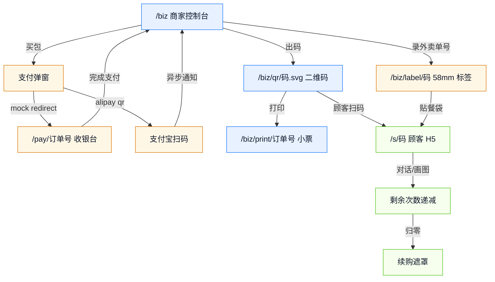

# 原型设计

## 1. 设计目标

移动优先、单主色、零框架、零构建。页面由服务端内联 HTML 输出，商家台在桌面 1080 px 宽度下呈现三列套餐与双列码卡，顾客页在 375 px 宽度下单列可用。所有状态必须可见：加载、空、错误、次数用尽。

设计令牌：主色 `#1677ff`（支付宝蓝），深色态 `#0e5fd8`，正文 `#0f172a`，次要文字 `#64748b`，边框 `#e6ebf4`，背景 `#f5f7fb`，成功 `#0f9d58`，警告 `#d97706`，错误 `#dc2626`。圆角：卡片 16 px、按钮 10 px、胶囊 999 px。

## 2. 页面地图

商家有两种进入方式：管理员输入 `X-Admin-Token`，或店主打开管理员给的 `/biz?t=<商家令牌>` 魔法链接。后者页面自动把令牌存进 `localStorage`，顶栏显示商家名并隐藏管理员专属的「商家邀请」区；只加载自己的订单、码与汇总。

按量付费没有面向人的页面：`/agent/mock-pay` 是给 Agent/脚本读的 JSON（`paymentProof` 等字段），`/agent/v1/chat/completions` 是协议端点。演示时把 402 响应体、`amtPaymentLink` 响应头与凭证重试放在同一屏对照即可，不需要新增 UI。

## 3. 商家控制台 `/biz`

| 区域 | 内容 | 交互 |
|---|---|---|
| 顶栏 | 品牌「外卖 AI · 商家台」+ 管理令牌输入；商家链接进入时显示商家名 | 令牌存 `localStorage`，点「进入」后加载 |
| 数据卡 | 累计营收、已付订单、已核销、在用码 | 四列，移动端两列 |
| 套餐区 | 套餐名、价格/次数、可用模型、有效期、说明 | 数量 1~20，点「购买」下单 |
| 订单区 | 订单号、商户、时间、状态、金额 | 待支付显示「去支付」，已支付显示「打印小票」 |
| 码卡片 | 74 px 二维码、码、剩余/总量、到期日 | 「撤销」二次确认 |
| 外卖单码区 | 单号输入框 + 「绑定出码」按钮；最近绑定列表 | 录入单号回车或点按钮即绑；成功后自动弹标签打印页，被拦截时提示可点「打印标签」重试 |
| 弹窗 | 支付宝二维码 + 支付链接文本 | 每 3 秒轮询订单状态，支付后自动关闭并刷新 |
| Toast | 操作结果与错误 | 1.8 秒自动消失 |

未登录时只显示登录壳，不请求数据；401 时回到登录壳并提示令牌无效。空订单显示「还没有订单。先买一个次数包，付款后自动出码。」

## 4. 顾客 H5 `/s/:code`

| 区域 | 内容 | 交互 |
|---|---|---|
| 首屏 | 商家名、套餐名、右上剩余次数胶囊 | 会话建立后填充 |
| 标签 | 「AI 对话」/「AI 画图」 | 切换面板，保留对话历史 |
| 对话 | 空态引导、用户气泡、AI 气泡、错误条 | 发送后显示三点打字动画；SSE 逐字追加 |
| 示例 | 开业祝福、招牌饮品、亲切改写、桌贴用法 | 点一下填入输入框并发送 |
| 输入 | 自适应高度 textarea + 发送按钮 | 空内容不发送，忙时禁止重复提交 |
| 画图 | 方图/竖图/横图尺寸、prompt、生成按钮 | 生成中禁用；结果两列网格 |
| 续购遮罩 | 「次数已用完」+ 联系商家文案 | 不可关闭，刷新后重新校验 |

加载态：会话请求期间按钮禁用；错误态：码无效/撤销/过期显示续购遮罩与明确原因；图片区初始为空，生成中显示「正在生成…」，无结果显示「没有返回图片」，请求失败显示「出错了：<原因>」。

## 5. mock 收银台 `/pay/:orderId`

420 px 居中卡片，橙色「演示收银台 · mock 支付」胶囊，套餐名、金额 34 px、订单号、主按钮「我已完成支付」。点击后按钮变「处理中…」，成功跳回 `/biz?paid=<订单号>`；失败恢复按钮并弹出原因。页面底部注明「此页仅用于本地演示；接入支付宝后由支付宝收银台接管。」

## 6. 打印小票 `/biz/print/:orderId`

A4 打印样式，双列网格，每张卡虚线边框、44 mm 二维码、16 pt 等宽码、套餐名、总次数、到期日、商家名。`@media print` 下 `@page size:A4; margin:0`，每卡 `break-inside:avoid`。页面加载 300 ms 后自动调起打印。未支付时返回 409 错误页「还没有核销码」。

## 7. 外卖单码标签 `/biz/label/:code`

58 mm × 40 mm 热敏纸，`@page{size:58mm 40mm;margin:0}`，单页单码。版式从上到下：商家名（12 pt 粗）、套餐与次数（10 pt）、外部订单号（11 pt 等宽，未绑定时留空）、26 mm 二维码居中、到期日（9 pt 灰）。二维码下印短码便于人工核对。页面加载后自动调起打印；码不存在或不属于当前身份返回 404 错误页。

## 8. 状态覆盖

| 页面 | 加载 | 空 | 错误 | 边界 |
|---|---|---|---|---|
| 商家台 | 数据请求中骨架 | 无订单提示 | 令牌无效/网络失败 toast | 数量超 20 被后端拒绝 |
| 顾客页 | 会话建立中 | 无对话/无图片 | 码不可用/上游失败条 | 剩余 0 时遮罩 |
| 收银台 | 处理中按钮 | — | 支付失败可重试 | 已支付跳回商家台 |
| 打印页 | 浏览器加载 | — | 订单不存在/未出码 | 一单多码自动分页 |
| 外卖标签 | 浏览器加载 | — | 码不属于当前身份 404 | 池空时绑定 409，页面提示先买包 |

## 9. 可访问性与响应式

按钮最小高度 40 px；文字与背景对比度 ≥ 4.5:1；输入框有 placeholder 与可读标签；二维码 SVG 带 `aria-label`；弹窗与遮罩不依赖颜色单独传达状态。断点 820 px：数据卡两列、套餐单列、码卡单列；375 px 下无横向滚动。
