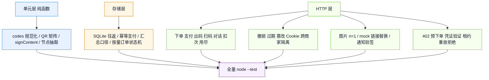
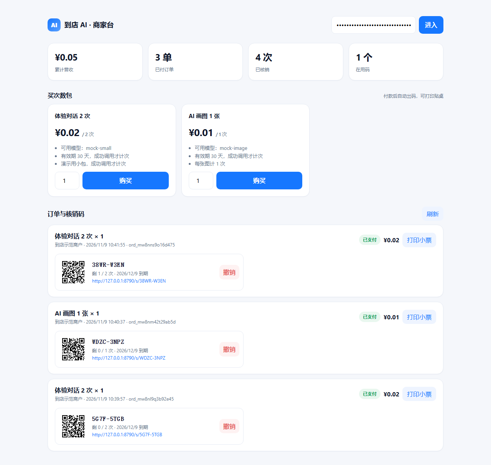
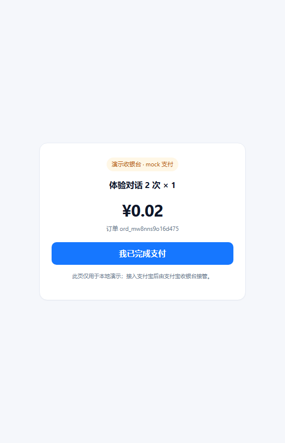
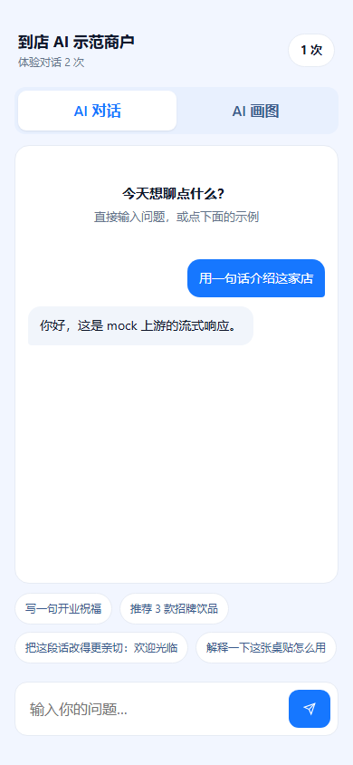
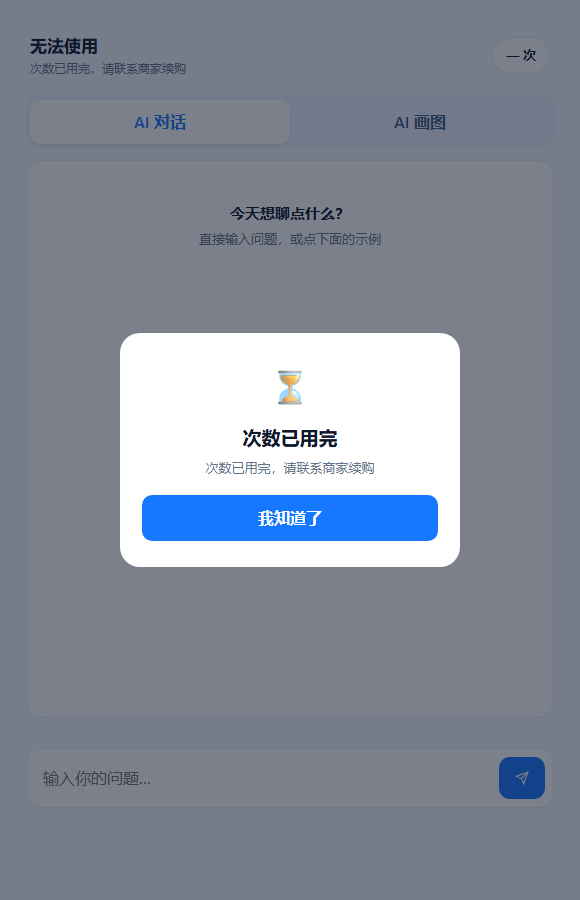

# 测试计划与用例

## 1. 范围与目标

本轮验证「商家买次数包 → 支付 → 出码 → 顾客扫码 → AI 调用 → 扣次 → 用尽」全链路，以及「Agent 调按量付费接口 → 402 → 支付凭证 → 履约」的第二个卖法。测试直接驱动真实 HTTP 与真实 SQLite 业务库，不使用页面静态断言替代接口行为。目标：全量 0 fail，新增业务用例覆盖成功、边界、错误三路。

未纳入本轮：真实支付宝沙箱/生产扣款、真实手机扫码、多实例共享次数闸门、真实 Agent 客户端自动支付。这些在本文第 7 节列为未验证项，不伪装成已通过。

## 2. 测试分层



## 3. 新增用例

| 编号 | 用例 | 关键断言 |
|---|---|---|
| BIZ-01 | 下单 → mock 支付 → 出码 → 扫码 → 对话扣次 → 用尽 | 2 个码、二维码 SVG、Cookie 会话、流式含 mock 文案、剩余 2→1→0、第 4 次 402、上游只收到 3 次、汇总营收 6/已付 1/核销 3/已售 6/在用 1、无令牌 401 |
| BIZ-02 | 上游失败不计次 | 强制 500 后剩余仍为 1；切回正常场景成功调用后剩余归 0 |
| BIZ-03 | 撤销 / 过期 / 不存在 / 篡改 Cookie / 跨商家隔离 | 撤销与过期返回 410；不存在与格式错误返回 400/410；篡改 Cookie 401；甲店码不能出现在乙店订单里 |
| BIZ-04 | 页面与路由 | `/biz` 200、`/s/CODE` 200、套餐未授权 401/授权 200、打印支付前 401 支付后 200、伪造支付令牌 403、根端点列出 `biz`/`scan`/`bizApi` |
| BIZ-05 | 图片按次计费 | 请求 `n=3` 仍转发 `n=1`；mock 假链接改写为 `data:image/svg+xml;base64,`；剩余次数减 1 |
| BIZ-06 | 码规范化与二维码结构 | 大小写/连字符归一；QR 尺寸 ≥21；左上/右上/左下定位图案存在；SVG 含 viewBox 与 path |
| BIZ-07 | SQLite 业务库往返 | 订单快照字段完整；重复 `markPaid` 返回 false；`incrementUsed` 生效；汇总营收 3/已核销 1 |
| BIZ-08 | 支付宝适配器 | 假网关收到 `alipay.trade.precreate`、`app_id`、RSA2、`out_trade_no`、金额 6.00；通知验签成功；金额不符与伪造签名被拒；重复通知幂等；`signContent` 去掉 `sign/sign_type/空值` 并按字典序 |
| BIZ-09 | 按量付费 402 全链路（mock） | 无凭证 402 且不触达上游；`amtPaymentLink` 以 `amtpp_mock_` 开头；再次请求复用同一 `outTradeNo`；演示支付后带凭证 200 且上游只收 1 次；同一凭证重放 402 `payment_trade_used`；履约后新请求开新单 |
| BIZ-10 | 按量付费坏凭证 | 金额不符 `payment_amount_mismatch`；订单不存在 `payment_order_mismatch`；格式非法 `payment_proof_invalid`；三者均 402 且上游 0 次 |
| BIZ-11 | 上游失败可重试 | 强制 500 时返回 ≥500；订单退回 `paid`；同一凭证重试 200；第三次 402 `payment_trade_used`；上游共收到 2 次 |
| BIZ-12 | 按量付费支付宝适配器 | 请求签名可被公钥验过；`biz_content` 含 `service_id/amount/currency/out_trade_no/pay_before`；响应验签通过才放行；金额不符 402；未签名响应 502 `payment_verify_failed`；重放 402 |
| BIZ-13 | 按量订单状态机 | `pending → paid → processing → consumed`；`processing` 期间不可重复领取；失败退回 `paid`；跨 SQLite 重开状态不丢；同一 `trade_no` 第二张单 `markMachinePaid` 返回 false |
| BIZ-14 | 按量纯函数 | 响应业务节点原文抽取（含字符串里的 `}{`）；`Payment-Proof` Base64 解析与非法输入拒绝 |
| BIZ-15 | 按量配置门禁：越界 | `priceCny=51`、`payBeforeMinutes=1000`、空 `models`、alipay 缺 `serviceId`、alipay 缺凭据全部报 error；1000 分钟不会被夹成 720 后放行 |
| BIZ-16 | 按量配置门禁：开关 | `machinePay.enabled=true` 但 `business.enabled=false` 报 error（避免 `/agent` 静默不挂载） |
| BIZ-17 | 按量配置归一化 | 非法价格归 0 交门禁报错；`payBeforeMinutes=0` 回落 10；商品名缺省；模型数组过滤非字符串/空串 |
| BIZ-18 | 按量配置：mock 缺 serviceId | mock 模式缺 `serviceId` 只告警并回落到 `mock-service`，不阻塞本地演示 |
| BIZ-19 | 外卖单码：同单号只出一个码 | `#MT 2026 1109 001` 归一化为 `MT20261109001`；首绑 `reused=false`、池剩 1；换大小写重录 `reused=true` 且返回同码、池仍 1；第二单绑走最后一张码后池 0；第三单 409 `slip_pool_empty`；绑出的码扫码可开会话且剩余 2；标签页含 `58mm`、单号与 `<svg>`，无令牌 401；列表 2 条按时间倒序 |
| BIZ-20 | 外卖单码：跨商家隔离 | 甲乙两店绑同一个 `ORD-SAME-001` 得到不同码、各显自家店名；甲拿乙的 `labelPath` 404；列表各 1 条；非法单号 400；无令牌 401 |

## 4. 边界与错误矩阵

| 输入 | 期望 |
|---|---|
| 套餐 ID 不存在 | 400 `pack_not_found` |
| 数量 0 / 21 / 小数 | 统一取整后拒绝，400 `invalid_quantity` |
| 码格式错误 | 400 `invalid_code` |
| 码不存在 / 已撤销 / 已过期 | 410，文案区分原因 |
| 次数用尽 | 402 `uses_exhausted` |
| 已支付订单再取支付链接 | 409 `order_not_pending` |
| 伪造 mock 支付令牌 | 403 `bad_pay_token` |
| 支付宝通知金额少 0.01 以上 | 回 `failure`，订单保持 `pending` |
| 支付宝重复通知 | 回 `success`，不重复出码 |
| 请求体超 `maxBodyBytes` | 413 `request_too_large` |
| 顾客 Cookie 被篡改 | 401 `session_expired` |

## 5. 执行方式

```bash
cd api-relay
npm run typecheck
npm run build
npm test
```

测试脚本使用 `node --experimental-sqlite --disable-warning=ExperimentalWarning --test "dist/test/*.test.js"`。判定只看 TAP 汇总的 `# pass` 与 `# fail`，不以管道退出码代替。业务用例位于 `src/test/biz.test.ts`，其余回归用例在 `src/test/*.test.ts`。

## 6. 通过标准

1. `# fail 0`，业务 10 项 + 按量付费 6 项 + 配置门禁 4 项全部通过，全量 300 项通过。
2. 失败路径必须证明「不计次」：同一码失败前剩余 N，失败后仍为 N。
3. 安全路径必须证明「拒绝」：伪造令牌、篡改 Cookie、金额不符、错误签名都返回非 2xx 与明确 code。
4. 幂等路径必须证明「只发生一次」：重复支付通知不重复出码，重复 `markPaid` 返回 false。
5. 浏览器实测完成闭环并留截图；QR 用独立解码器还原 URL 比对。

## 7. 未验证项

| 项 | 原因 | 当前证据边界 |
|---|---|---|
| 真实支付宝沙箱扣款 | 需要商家 APPID、私钥、公网 `notifyUrl` | 只证明请求签名可被公钥验过、通知校验与幂等成立 |
| 按量付费真实预下单/验证 | 需要支付宝分配的 `service_id` 与商户密钥 | 用假网关验证请求签名、响应验签与全部分支；未对支付宝生产环境发起调用 |
| 真实 Agent 客户端自动支付 | 需要支持 402 与 AI 付的客户端 | 用 `curl` + mock 凭证跑通协议；客户端侧行为不在本轮 |
| 真实手机扫码打开 | 本机地址为 `127.0.0.1`，手机不可达 | 用解码器验证二维码内容，页面用桌面手机视口验证 |
| 多实例并发扣次 | `inflight` 为进程内预留 | 单进程并发不超卖；多实例按库内 `uses_used` 兜底 |
| 上游内容质量 | mock 上游只返回固定文案 | 产品链路与计费口径可验证，模型质量不在本轮范围 |
| 外卖平台订单接口对接 | 平台不向个体商户开放订单查询 API，需资质与商务合作 | 只验证「商家录入/扫码得到单号 → 服务端绑定」这一段；单号来源（手输、扫码枪、未来平台对接）对绑定逻辑等价 |

## 8. 实机验证记录

2026-11-09 在本机完成一次完整实机走查。环境：Node v22.23.2、Edge headless、mock 上游 `127.0.0.1:8899`、网关 `127.0.0.1:8790`、独立临时 `biz.db`。为在数秒内走到用尽态，演示包配置为「体验对话 2 次 / ¥0.02」与「AI 画图 1 张 / ¥0.01」；正式定价见 `config/relay.example.yaml`。

| 项 | 实测结果 |
|---|---|
| 下单 → mock 收银台 → 支付 → 出码 | 订单状态 `pending → paid`，自动出码，商家台营收/已付/在用码同步更新 |
| 对话扣次 | 两次成功调用后剩余 `2 → 1 → 0`；第三次返回 402 `code_unusable`，消息列表不增加 |
| 图片扣次 | 生成 1 张后剩余 `1 → 0`，返回 `data:image/svg+xml` 占位图，续购遮罩出现 |
| 打印页 | 带管理令牌 200，内容为 1 张票 1 个二维码；不带管理令牌 401 |
| 二维码可扫 | 两个码 × 缩放 4/8 共 4 组，jsQR 全部还原为 `publicBaseUrl + /s/<code>` |
| 响应式 | 商家台 1280 px、顾客页 390 px 均无横向溢出 |

### 8.1 商家台



### 8.2 mock 收银台



### 8.3 顾客对话（390 px）



### 8.4 次数用尽



### 8.5 打印小票


### 8.6 按量付费 402 全链路

同日另起一套环境：mock 上游 `127.0.0.1:8899`、网关 `127.0.0.1:8791`、`business.machinePay` 为 mock、单价 ¥0.01、`payBeforeMinutes=10`、模型 `mock-small`，独立临时库。用 `curl` 按 Agent 客户端姿势跑五步：

| 步骤 | 请求 | 实测结果 |
|---|---|---|
| 1 | `POST /agent/v1/chat/completions`，无 `Payment-Proof` | `HTTP/1.1 402 Payment Required`，响应头 `amtPaymentLink: amtpp_mock_mp_…`，体内含 `out_trade_no`、金额与支付截止 |
| 2 | 打开 402 给出的 mock 支付链接 | 返回 `tradeNo=mock_…`、`outTradeNo=mp_…` 与标准 `Payment-Proof` |
| 3 | 带 `Payment-Proof` 重发同一请求 | `HTTP/1.1 200 OK`，体内为 mock 上游 `chat.completion`，订单转 `consumed` |
| 4 | 用同一份凭证再发一次 | `HTTP/1.1 402 Payment Required`，`code=payment_trade_used`（`trade_no` 唯一索引拒绝重放） |
| 5 | 订单已消费后再开 mock 支付链接 | `HTTP/1.1 409`，链接不再能换来凭证 |

这五步同时验证了「未付 → 402」「付一次 → 通一次」「凭证不可复用」「已消费订单不可再出凭证」四条语义。真实支付宝预下单/验证仍列在 §7 未验证项。

### 8.7 外卖单码绑定

同日再起一套环境（`127.0.0.1:56020`、临时 `biz.db`、管理令牌 `slip-e2e-token`），购买「外卖单码 2 次 × 2 张」并 mock 支付，然后：

| 步骤 | 操作 | 实测结果 |
|---|---|---|
| 1 | 绑定 `MT20261109001` | 200，`reused=false`，出码 `9HT9-SGT1`，`usesTotal=2`，池剩 1 |
| 2 | 原样再绑一次 | 200，`reused=true`，`sameCode=true`，池仍 1（重复录入不吃码） |
| 3 | 取 58mm 标签页 | 200，4308 字节，含 `58mm`、`MT20261109001`、`<svg>` |
| 4 | 商家台页面 | 200，含「外卖单码」面板与绑定输入框 |
| 5 | 浏览器实测：输入单号点绑定 | 出码 `CG5R-P62S`，结果行显示「池内还剩 1 个」；再次输入同单号返回原码 `9HT9-SGT1` 并提示「已绑过，返回原码」 |
| 6 | 标签几何（同源 iframe 渲染后量） | 纸张 219 × 151 px = 58mm × 40mm，二维码 98 px 且完全在纸内，不被裁切 |
| 7 | 用绑出的码开顾客会话并对话一次 | 剩余 2 → 1，扣次口径与普通核销码一致 |
