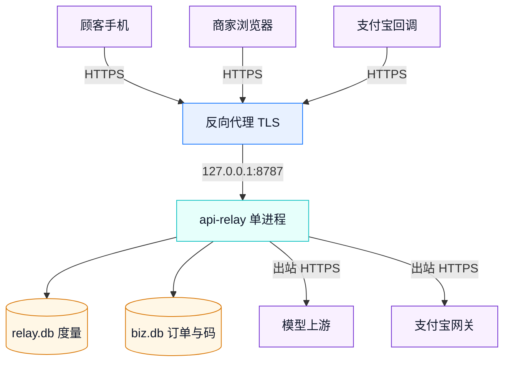

# 部署与运维手册

## 1. 运行环境

| 项 | 要求 |
|---|---|
| Node.js | ≥ 22.5（使用内置 `node:sqlite`） |
| 运行时依赖 | 0 个；无需 `npm install --production` |
| 操作系统 | Linux x64 / Windows x64 / macOS |
| 端口 | 默认 8787，可用 `server.port` 与 `RELAY_PORT` 覆盖 |
| 磁盘 | 度量库与业务库各一个 SQLite 文件；WAL 模式 |
| 反向代理 | 生产必须由代理终结 TLS，应用内不实现 TLS |

## 2. 部署拓扑



单实例部署即可支撑比赛演示与小型门店。水平扩展前先读第 9 节的并发边界：限流、额度、次数预留都是每实例独立。

## 3. 配置

最小可用片段（完整示例见 `config/relay.example.yaml`）：

```yaml
business:
  enabled: true
  publicBaseUrl: "https://ai.example.com"
  merchantName: 外卖 AI 示范商户
  sessionTtlHours: 12
  costCapRatio: 0.9
  packs:
    - id: chat-100
      name: 标准对话 100 次
      uses: 100
      priceCny: 9.9
      models: [mock-small]
      validDays: 90
  payments:
    provider: mock
```

支付宝模式把 `provider` 改为 `alipay`，补 `appId / privateKey / alipayPublicKey / gateway / notifyUrl`。密钥必须写成 `{ENV:...}`，对应环境变量 `ALIPAY_APP_ID`、`ALIPAY_APP_PRIVATE_KEY`、`ALIPAY_PUBLIC_KEY`。`notifyUrl` 指向 `https://<域名>/biz/api/alipay/notify`。

### 3.1 AI 按量付费（HTTP 402）

给 Agent/脚本调用方的第二个卖法，按次收钱，与商家次数包互不影响：

```yaml
business:
  machinePay:
    enabled: true
    provider: alipay          # 本地评审可先用 mock
    serviceId: API-XXXX       # 支付宝分配的按量付费服务标识
    priceCny: 0.01            # 单次价格，支付宝硬上限 50 元
    goodsName: AI 调用（每次）
    payBeforeMinutes: 10      # 1..720，支付宝要求不超过 12 小时
    models: [mimo-v2.5-pro]   # 必须由某个健康上游提供
    # resourceId: out_res_id_demo
```

`provider: alipay` 时密钥复用 `business.payments.alipay`（同一套 APPID/私钥/支付宝公钥），
**按量付费不依赖 `notifyUrl`**：它在每次重试时同步调 `alipay.aipay.agent.payment.verify` 验证凭证。
`provider: mock` 不需要任何资质，402 响应里会多一个 `/agent/mock-pay?...` 演示支付链接，
点开即得到标准 `Payment-Proof`；启动日志会打印 `biz.machine_pay_mock` 告警——
这模式任何人拿了链接都能免费换凭证，**只许用于本地评审**。

`relay check` 会单列「AI 按量付费（HTTP 402）」段，显示入口、单价、`service_id` 与模型；
`provider: alipay` 缺密钥会在配置校验阶段直接报错，不会悄悄降级。

## 4. 启动与停止

```bash
node dist/cli.js check --config config/relay.yaml   # 先自检，不加载密钥也能跑
export RELAY_ADMIN_TOKEN=$(openssl rand -hex 24)
node dist/cli.js serve --config config/relay.yaml
```

启动日志应出现 `biz.ready`，字段 `packs` 为套餐数，`provider` 为 `mock` / `alipay`。停止用 `SIGTERM`，服务在 `shutdownGraceMs` 内优雅退出并关闭业务库。systemd 单元与容器示例见 `docs/DEPLOYMENT.md` 第 2 节。

## 5. 反向代理与二维码地址

代理必须保留 `Host`、`X-Forwarded-For`、`X-Forwarded-Proto`，并按需调大读超时以支持 SSE。若配置了 `server.trustProxy` 才信任转发头。

二维码内容由 `business.publicBaseUrl` 拼 `/s/<code>`。该值为空时使用请求 `Host`，本机演示会被手机扫成 `127.0.0.1`，属于预期限制。生产上线前必须把它设为手机可达的 HTTPS 域名，再重新出码。

## 6. 备份与恢复

| 操作 | 命令 |
|---|---|
| 备份度量库 | `sqlite3 data/relay.db ".backup 'backup/relay.db'"` |
| 备份业务库 | `sqlite3 data/biz.db ".backup 'backup/biz.db'"` |
| 恢复 | 停服务 → 覆盖两个库 → 启动 → 核对 `GET /biz/api/summary` |
| 校验恢复 | 营收、已付订单、已核销次数与备份前读数一致 |

只备份 `relay.db` 会丢订单、核销码与核销进度。备份文件包含商户名与金额，按经营数据管理访问权限。

## 7. 监控与日志

| 事件 | 级别 | 关键字段 |
|---|---|---|
| `biz.ready` | info | `packs`, `provider`, `storage` |
| `biz.order_created` | info | `orderId`, `packId`, `quantity`, `amountCny` |
| `biz.order_paid` | info | `orderId`, `provider` |
| `biz.codes_issued` | info | `orderId`, `count` |
| `biz.call_done` | debug | `orderId`, `status`, `counted`, `path` |
| `biz.call_failed` | warn | `orderId`, `error` |
| `biz.notify_rejected` | warn | `reason` |
| `biz.notify_amount_mismatch` | warn | `orderId`, `expected`, `got` |
| `biz.payment_create_failed` | warn | `orderId`, `error` |
| `biz.machine_precreate_failed` | error | `error` |
| `biz.machine_verify_upstream_failed` | warn | `reason` |
| `biz.machine_pay_call` | debug | `outTradeNo`, `tradeNo`, `status`, `counted` |
| `biz.machine_pay_mock` | warn | 启动时打印，提醒 mock 不能上线 |

健康检查用 `GET /healthz`。业务侧巡检：`GET /biz/api/summary` 的 `activeCodeCount`、`usesUsed/usesSold`；控制台订单列表看支付状态。日志不输出 key、私钥、完整 Authorization。

## 8. 故障排查

| 现象 | 检查 |
|---|---|
| `/biz` 404 | `business.enabled` 是否为 true；`relay check` 的「扫码次数包」段 |
| 下单 502 `payment_create_failed` | 支付宝网关可达性、APPID/私钥、`notifyUrl`；订单已创建，可点「去支付」重试 |
| 支付后不出码 | 通知是否到达 `/biz/api/alipay/notify`；金额是否与订单一致；日志 `biz.notify_*` |
| 顾客扫码打不开 | `publicBaseUrl` 是否为手机可达地址 |
| 顾客 402 | 码次数是否用尽；`uses_used` 与 `uses_total` |
| 顾客 410 | 码是否撤销、过期、被删库 |
| 调用成功但次数没减 | 响应是否 2xx 且流完整；日志 `biz.call_done` 的 `counted` |
| 支付重复回调 | 预期行为；`markPaid` 条件更新与 `ensureCodes` 保证幂等 |
| `/agent/*` 404 `machine_pay_disabled` | `business.machinePay.enabled` 是否为 true |
| 按量付费 402 `precreate_failed` | 支付宝网关可达性、`serviceId` 是否注册、`priceCny` 是否 ≤50 且 >0 |
| 按量付费 502 `payment_verify_failed` | 支付宝响应未签名/验签失败/网关 5xx；看 `biz.machine_verify_upstream_failed` 的 `reason`，不要改凭证 |
| 按量付费 402 `payment_in_progress` | 有并发请求持有 5 分钟租约；等租约过期或查该 `outTradeNo` 是否卡在 `processing` |
| 按量付费 402 `payment_trade_used` | 该 `trade_no` 已履约；这是防重复交付，不是故障 |
| 按量付费 402 `payment_order_mismatch` | 凭证的 `out_trade_no` 不是本服务签发；检查是否连到另一实例/另一份 `biz.db` |

## 9. 容量与并发边界

单进程内 `inflight` 预留保证并发请求不超过剩余次数；进程重启后预留清零，以库内 `uses_used` 为准。多实例部署时每个实例独立预留，可能出现小幅超卖。限流、周期额度、熔断状态同样是每实例独立。比赛演示与单店场景使用单实例；需要强一致多实例时先迁移业务库到共享数据库并引入分布式预留。

## 10. 按量付费入口运维（HTTP 402）

### 10.1 mock 全链路自检（无商户资质）

```bash
BASE=http://127.0.0.1:8787
# 1) 无凭证：应回 402，响应头带 amtPaymentLink，响应体带 payment.mockPayUrl
curl -si -X POST $BASE/agent/v1/chat/completions \
  -H 'content-type: application/json' \
  -d '{"messages":[{"role":"user","content":"hi"}]}'

# 2) 打开 mockPayUrl（把上一步的 payment.mockPayUrl 原样拼在 BASE 后）
curl -s "$BASE/agent/mock-pay?order=mp_...&t=..."     # 得到 paymentProof

# 3) 带凭证重试：应回 200
curl -si -X POST $BASE/agent/v1/chat/completions \
  -H 'content-type: application/json' \
  -H "Payment-Proof: $PROOF" \
  -d '{"messages":[{"role":"user","content":"hi"}]}'

# 4) 同一凭证再发一次：应为 402 payment_trade_used
```

判定看三处：第 1 步上游未收到请求（未支付不交付）、第 3 步 200、第 4 步拒绝。
`biz.machine_pay_call` 的 `counted` 是「这次调用是否算履约成功」，失败会退回 `paid` 允许重试。

### 10.2 生产前置条件

| 项 | 要求 |
|---|---|
| 公网 HTTPS | Agent 侧要能访问入口；反向代理终结 TLS，读超时覆盖 SSE |
| 支付宝服务 | 已注册 AI 按量付费并拿到 `serviceId`；APPID/私钥/支付宝公钥与当面付共用 |
| 模型供给 | `machinePay.models` 中的模型必须由健康上游提供，否则付了钱也只会得到上游错误 |
| 定价 | `priceCny` 在 (0, 50] 元；`payBeforeMinutes` 在 [1, 720] 分钟 |
| 数据 | `biz.db` 的备份现在同时包含次数包与按量付费订单，按第 6 节一起备份 |
| 关闭演示 | 上线必须 `provider: alipay`；mock 模式启动日志会告警，且任何人都能免费换凭证 |

### 10.3 口径与边界

- 一笔 `trade_no` 只能履约一次（库内部分唯一索引）；重放返回 402，不是 500。
- 上游失败**不消耗**支付：订单退回 `paid`，同一凭证可重试；只有 2xx 才 `consumed`。
- 待付单按 `serviceId + 金额` 复用，未支付不会无限建单；已履约订单按经营数据长期保留。
- 多实例部署时，`biz.db` 必须共享或只跑单实例；否则 A 实例签发的订单在 B 实例查不到，会报 `payment_order_mismatch`。

## 11. 安全清单

管理令牌 ≥24 随机字符并只走 HTTPS；支付宝私钥只放环境变量；`notifyUrl` 对外可达且验签；按量付费只信验签过的 verify 响应（`active`、金额、订单号、`trade_no` 四项全对才交付），不把 `payment_proof` 落库；业务库与备份文件权限最小化；不把 `biz_sid` 写进日志；撤销码后确认对应 key 已失效；定期检查 `relay check` 的告警项。回滚方式：恢复上一版二进制与两个数据库备份，保持 `business.enabled` 原值。
